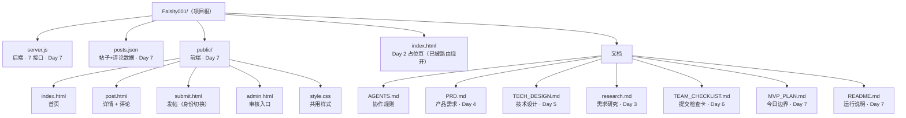

# 项目 · MVP（Day 7）

社会认知 / 职场经验分享网站。本仓库当前是 MVP 第一版 —— 只做能演示核心规则的最小集合。

> 项目名暂未定型，Day 8+ 再正式取名。

## 一键启动

需要本机装了 Node.js（推荐 18+）。

```bash
node server.js
```

启动后会看到：

```
[day7-mvp] listening on http://localhost:8080
```

浏览器打开 [http://localhost:8080/](http://localhost:8080/) 即可。

按 `Ctrl + C` 停止服务。

## 试不同身份（演示用）

身份由 URL 参数切换，**没有登录、没有会话**，纯粹为了演示不同身份走不同路径：

| 身份 | 链接 | 能做什么 |
|---|---|---|
| 未认证（默认） | [`/submit?as=anonymous`](http://localhost:8080/submit?as=anonymous) | 只能发「提问」帖，发布后进审核 |
| 已认证 | [`/submit?as=verified`](http://localhost:8080/submit?as=verified) | 可发「观点」或「提问」，发布后直接上首页 |

其他页面：

| 路径 | 用途 |
|---|---|
| `/` | 首页：列已通过审核的帖子 |
| `/post/:id` | 帖子详情 + 评论列表 + 提交评论 |
| `/submit?as=...` | 发帖页（带身份切换） |
| `/admin` | 审核入口：待审核列表，通过 / 拒绝 |

## 文件结构



> 隐藏目录 `.git/`（git 内部）、`.workbuddy/`（开发助手数据）、`.env`（凭据，已排除）不在图里。

## 数据存储

- 帖子 + 评论统一在 `posts.json`
- 没有数据库（按 PRD 砍功能，Day 23 才引入）
- 启动时会读这个文件，写操作会覆盖写入
- 想恢复种子数据：在 git 里 `git checkout posts.json`（前提是已经 commit 进 git）

## 规则说明（这版 MVP 的规则）

所有判定都在 `server.js` 里，**前端只负责展示**。PRD 的核心规则：

- 已认证用户：可发「观点」或「提问」，直接上首页
- 未认证用户：只能发「提问」，发布后进入待审核，不在首页展示
- 评论：谁都能发，立即显示
- 审核：通过 → 上首页；拒绝 → 从文件删除

## 这版 MVP 不做的事

- ❌ 注册 / 登录 / 密码 / 会话（演示用 URL 参数切身份）
- ❌ 真实公司认证流程（演示用 `?as=verified` 模拟）
- ❌ AI 自动审核（管理员人工审核）
- ❌ 手机端样式（只测桌面浏览器）
- ❌ 数据库（Day 23 才引入，目前用 `posts.json`）
- ❌ 点赞 / 私信 / 关注 / 缓存 / 支付
- ❌ 项目正式命名（Day 8+ 再定）

## Skill 与发布前检查

本仓库的 Skill 放在 [`skills/`](./skills/) 下，**每个 Skill 一个目录**，含 `SKILL.md`（怎么用）+ `RUN_LOG.md`（历次调用记录，只追加不覆盖）+ 可选的 `CHECKLIST.md`（设计依据）。

### release-check：发布前检查（Day 25 加）

**什么时候用**：要部署/发布/上线之前，或改过 `functions/api/*.js`、`public/*.html`、`.gitignore`、`.env` 相关文件之后。

```bash
node release-check.mjs
```

想出截图/存档报告就加 `--html`：

```bash
node release-check.mjs --html day25-out/check.html
```

**退出码**（可以直接用在脚本里判断）：

| 码 | 含义 |
|---|---|
| `0` | 已实现项全部通过 |
| `1` | 有失败项 |
| `2` | **脚本自身出错**（网络/环境问题）——**不等于检查失败**，别误判成后端故障 |

**当前实现范围**（设计依据见 [`skills/release-check/CHECKLIST.md`](./skills/release-check/CHECKLIST.md)）：

| 编号 | 检查项 | 状态 |
|---|---|---|
| C1 | 密钥泄漏 | ✅ 已实现 |
| C2 | 公网可达性 |✅ 已实现 |
| C3 | 接口契约一致 | ⏳ 未实现 |
| C4 | 前端错误提示规范 | ⏳ 未实现 |
| C5 | Git 工作区干净 | ⏳ 未实现 |

C3–C5 **没实现，输出里就标「未实现」，不算通过**。

两个注意点：

- **C2 探活只发 GET**，不发 POST/PATCH/DELETE —— 避免污染线上数据，也避开已知的收藏接口唯一索引冲突。
- **C1 的判定是「变量名旁有没有像密钥的字面量」**，不是「有没有出现变量名」。仓库里 `API_KEY` 字样出现 9 处全是干净写法（`process.env.CLOUDBASE_API_KEY`、`Bearer ${API_KEY}`），不该被误报。

> ⚠️ **「通过」本身需要被验证。** 一个只会说「通过」的检查工具，和一个坏掉的检查工具，在结果上无法区分。Day 25 建这个 Skill 时做过一次反向验证（故意注入密钥 → 它报警 → 修掉 → 它安静），记录在 [`RUN_LOG.md`](./skills/release-check/RUN_LOG.md)。改动检查逻辑后，建议重做一次。

### filter-check：首页分类筛选检查（Day 12 加）

改了 `public/index.html` 的筛选逻辑、`posts.json` 数据或 `chip` 相关样式后跑。按 `skills/filter-check/SKILL.md` 里的步骤在真浏览器里点一遍，三种情况（有结果 / 无结果 / 清空恢复）都要测。

### 写新 Skill 的约定

- 目录：`skills/<名字>/`
- `SKILL.md` 开头写 YAML frontmatter（`name` + `description`），`description` 里写清「**什么时候必须调用它**」
- 正文写：前置条件 / 操作步骤 + 每步的通过标准 / 失败时怎么办
- 结尾写死「调用记录追加到 `RUN_LOG.md`，格式如何」
- 明确列出「**什么不算问题**」——避免下一轮误报自己打自己
- 有意未实现的部分要显式标注，不许装成已通过

## 下一步

- Day 8+：项目正式命名、引入 Express（替换内置 http 模块）、拆前端资源、引入 npm 包管理
- Day 23：替换 `posts.json` 为真实数据库

详细计划见 [`MVP_PLAN.md`](./MVP_PLAN.md)。